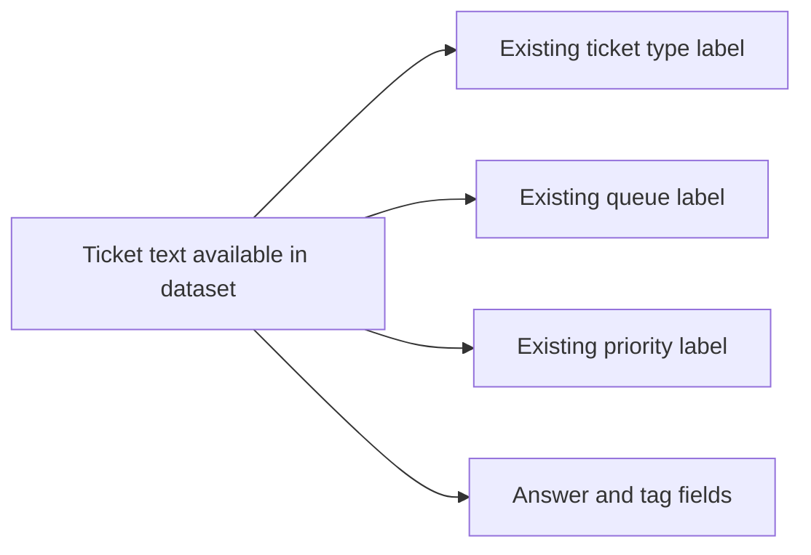

# Process Analysis: Current View and Proposed Flow

**Document:** Process analysis  
**Version:** 1.0  
**Status:** Current view is dataset-based; future flow is proposed

## 1. What is known about the current process

The selected dataset contains ticket subject, body, answer, ticket type, queue, priority, language and tag fields. It therefore provides examples of ticket text alongside existing classification labels.

It does **not** describe the actual operational process. There is no documented sequence of ticket creation, assignment, reassignment, agent review, resolution or closure. The current-state view below is deliberately limited to what the dataset shows.

### Dataset-level current-state view

This is a representation of the available data, not a verified business process.

## 2. Current-state questions for discovery

Before implementation, stakeholders should confirm:

- Where does a new ticket enter the organisation's support process?
- Is initial classification performed by a person, rules, an existing model or a combination?
- Who selects the queue and priority?
- Can a ticket be reassigned, and how is that event recorded?
- What triggers escalation or manual review?
- Which system stores the authoritative assignment and resolution history?

## 3. Proposed future-state flow

The feature is designed as a recommendation step in an existing ticketing process.

1. The platform sends a new ticket to the routing feature.
2. The feature checks that usable text is present and that the language is supported.
3. It generates recommendations for ticket type, support queue and priority.
4. It calculates confidence and provides a short reason for each recommendation.
5. Cases below the agreed confidence threshold, or cases that fail validation, go to manual review.
6. An agent reviews the recommendation and confirms it or selects a different result.
7. The system stores the recommendation and final decision, including an override reason where required.
8. Monitoring reports classification performance, manual-review volume and overrides.

The confidence threshold, override policy and service-level targets remain open decisions. They should not be set from the dataset alone.

## 4. Human control

The model provides decision support. It does not silently assign a ticket or send a customer response. The agent remains responsible for confirming the final queue, type and priority. The workflow should make it possible to bypass the recommendation when the model is unavailable or the ticket is outside the supported scope.

## 5. Process risks to validate

- A model may learn patterns in the historical labels that do not reflect current routing policy.
- A recommendation can look confident while still being wrong, especially for less common queues.
- Poor input quality can reduce classification reliability.
- If overrides are not recorded consistently, there will be limited evidence for improving the feature.
- If manual review volume is too high, the proposed feature may add work rather than remove it.
