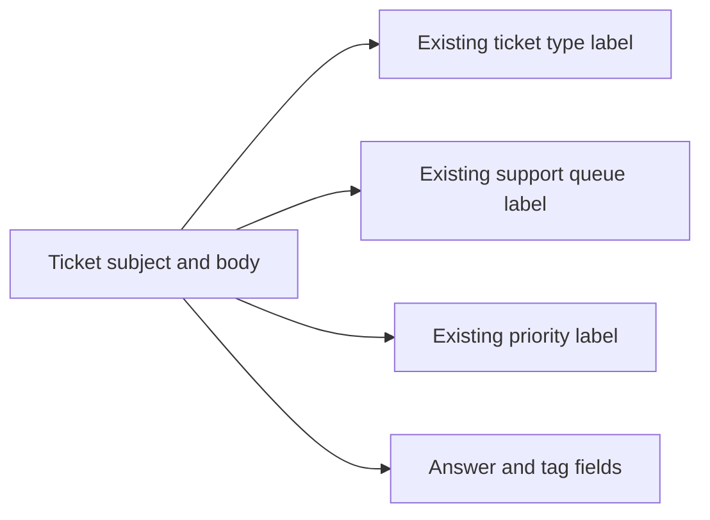
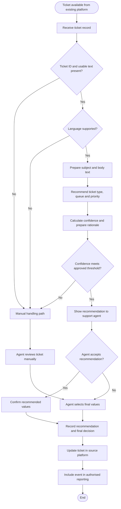
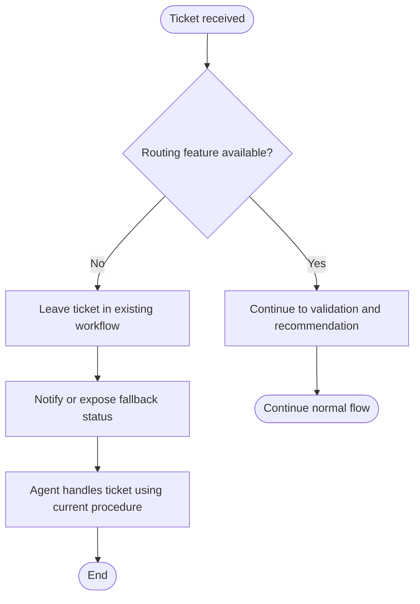

# Workflow Diagrams

**Document version:** 1.0  
**Status:** Proposed workflow; not a production process map

The diagrams use Mermaid flowchart syntax so they render in GitHub. They are workflow illustrations, not formal BPMN 2.0 models.

## 1. Dataset-level current view

The source dataset contains text fields and existing labels. It does not describe who assigned those labels or the sequence of operational steps.

## 2. Proposed future-state workflow

## 3. Exception path: model or integration unavailable

## 4. Design notes

- The existing ticketing platform remains the source of truth for the ticket and final assignment.
- Manual handling is available when input is invalid, language is unsupported, confidence is low or the model service is unavailable.
- The agent's final values must not overwrite the original recommendation in the audit record.
- The decision threshold and fallback procedure require operational approval.
- The exact integration, retry and duplicate-event behaviour require technical design.
